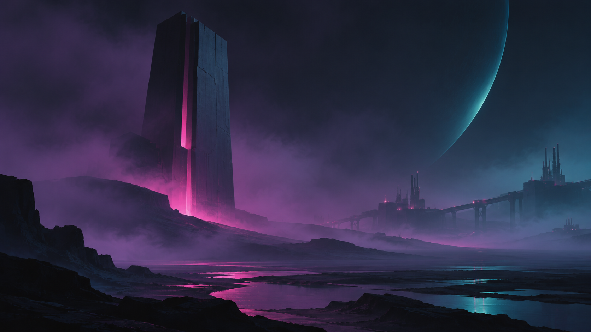
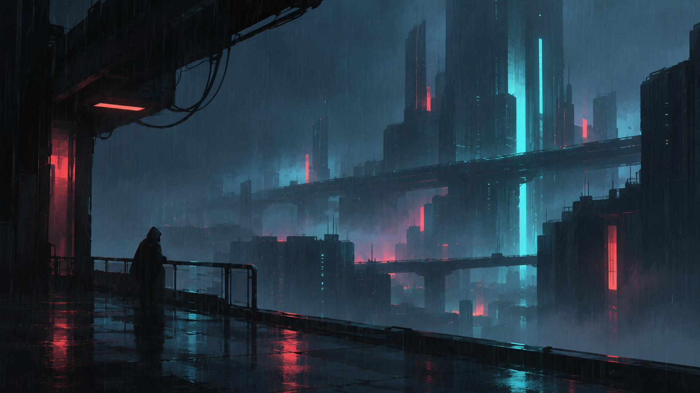

# Wallpapers

A small, curated collection of atmospheric science-fiction and industrial-noir desktop wallpapers, plus links to artwork by independent artists.

The collection keeps **files** and **references** separate:

- `wallpapers/`: Original images generated for this collection. These files are available when consumed as a Git/Nix input.
- This README: The index of linked artwork, with sources, artist credits, and usage notes. Externally hosted images are **not** mirrored or committed.

## Included images

| Violet Monolith | Rainy Megacity |
| --- | --- |
|  |  |
| `wallpapers/violet-monolith.png` | `wallpapers/rainy-megacity.png` |

Both images are 1672 × 941, generated as original concepts in this conversation. They are a starting selection, not native 4K artwork.

## External favorites

The collection is intentionally a set of links for these works, not a rehosting project.

| Wallpaper | Creator / source | Rights | Download or portfolio |
| --- | --- | --- | --- |
| Dystopian Dreams ★ | robokoboto | Personal use only | [Wallpaper Abyss](https://wall.alphacoders.com/big.php?i=1384548) |
| Starfield: Shattered Space ★ | Bethesda Game Studios | Publisher copyright | [Official wallpaper](https://bethesda.net/en/game/starfield/media/wallpaper/starfield-shattered-space-wallpaper) |
| Derelict Orbital Citadel | Paul Chadeisson | Personal use only | [Wallpaper Abyss](https://wall.alphacoders.com/big.php?i=1269192) |
| Celestial Megaship | AI-generated / publisher Fred | Unverified | [backiee](https://backiee.com/wallpaper/celestial-megaship-amidst-galactic-fog/302530) |
| Sci Fi City | Annibale Siconolfi | Personal use only | [Wallpaper Abyss](https://wall.alphacoders.com/big.php?i=1108470) |
| Futuristic Sci-Fi Cityscape | Annibale Siconolfi | Personal use only | [Wallpaper Abyss](https://wall.alphacoders.com/big.php?i=1223603) |
| Futuristic Space Colony | Paul Chadeisson | Personal use only | [Wallpaper Abyss](https://wall.alphacoders.com/big.php?i=928392) |
| Planet Science Fiction Among Stars | Unverified | Unverified | [HDQ Walls](https://hdqwalls.com/planet-science-fiction-among-stars-4k-wallpaper) |
| Cosmic Pyramids: Ancient Future | Unverified | Unverified | [HDQ Walls image](https://images.hdqwalls.com/download/cosmic-pyramids-ancient-future-yf-3840x2160.jpg) |
| Remember Me: Slum Neo-Paris | Paul Chadeisson | Artist copyright | [ArtStation](https://www.artstation.com/artwork/zmx6) |
| The Museum of Alien Life | Creator unverified | Unverified | [Behance](https://www.behance.net/gallery/106183577/The-Museum-of-Alien-Life) |

★ means an initial favorite, not a licensing designation.

## Use as a Nix flake input

In `repparw/nix/modules/aspects/style.nix`, add:

```nix
flake-file.inputs.wallpapers = {
  url = "github:repparw/wallpapers";
  flake = false;
};
```

The repo itself does **not** need a `flake.nix`. In the existing `stylix` `let` block, replace the current external `pkgs.fetchurl` image expression with:

```nix
inputImage = "${inputs.wallpapers}/wallpapers/violet-monolith.png";
```

Or select `wallpapers/rainy-megacity.png`. Keep the existing `pkgs.runCommand` dimming pipeline and `stylix.image = wallpaper` configuration unchanged. Since the Nix repo uses `flake-file`, regenerate its `flake.nix` using the existing `write-flake` workflow, then update the lock file.

**Important:** The externally hosted works listed above are not bundled into this input. To use one of them, download it for your own use and either keep it locally or reference it in `pkgs.fetchurl` with its fixed hash, subject to the source's terms. Do not assume its presence under `inputs.wallpapers`.

## Copyright and attribution

Original generated images are included here. **No third-party images are stored in this repository.** Linked artwork remains subject to each creator's and distributor's terms. Wallpaper Abyss labels several linked works "Free For Private, Personal Use," which is not a grant to republish those works in a public Git repository. Sources and attribution are preserved in the table above.

There is no blanket license for the included images. Decide on licensing explicitly before accepting contributions or redistributing the collection.
